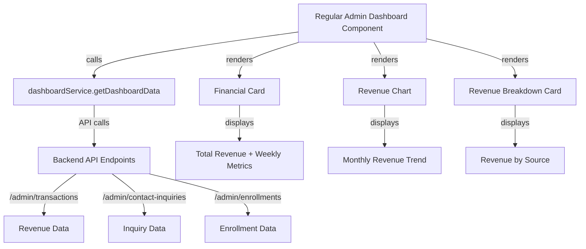

# Design Document: Regular Admin Dashboard Revenue Integration

## Overview

The Regular Admin Dashboard currently displays hardcoded operational metrics focused on content management and daily workflows. This design adds real revenue data integration by following the established pattern from SuperAdminDashboard, which successfully fetches live financial data from the backend API. The integration will display revenue metrics prominently while maintaining the existing operational focus and responsive layout of the Regular Admin Dashboard.

## Architecture



## Components and Interfaces

### RegularAdminDashboard Component

```javascript
interface RegularAdminDashboard {
  props: {
    user: {
      firstName: string
      name: string
      email: string
    }
  }
  state: {
    loading: boolean
    refreshing: boolean
    error: string | null
    dashboardData: DashboardData
  }
  methods: {
    fetchDashboardData(): Promise<void>
    handleRefresh(): Promise<void>
  }
}
```

### FinancialCard Component

```javascript
interface FinancialCard {
  props: {
    totalRevenue: number
    weeklyRevenue: number
    weeklyGrowth: number
    currency?: string
  }
  renders: {
    totalRevenueDisplay: string
    weeklyRevenueDisplay: string
    growthPercentage: number
    trendIndicator: 'up' | 'down' | 'stable'
  }
}
```

### ChartCard Component

```javascript
interface ChartCard {
  props: {
    title: string
    subtitle?: string
    data: Array<{ month: string, revenue: number }>
    color?: string
    type?: 'bar' | 'line'
  }
  renders: {
    chart: RechartsComponent
    monthLabels: string[]
    revenueValues: number[]
  }
}
```

### RevenueBreakdownCard Component

```javascript
interface RevenueBreakdownCard {
  props: {
    breakdown: {
      training: number
      jobs: number
      partnerships: number
      other: number
      growth: number
    }
  }
  renders: {
    trainingRevenue: string
    jobsRevenue: string
    partnershipsRevenue: string
    otherRevenue: string
    growthIndicator: number
  }
}
```

## Data Models

### DashboardData Model

```javascript
interface DashboardData {
  stats: {
    totalRevenue: number
    totalPayments: number
    completedPayments: number
    pendingPayments: number
    totalUsers: number
    activeUsers: number
    admins: number
    pendingKYC: number
    enrollments: EnrollmentStats
    totalJobs: number
    activeJobs: number
    pendingApplications: number
    totalInquiries: number
    unreadInquiries: number
    resolvedInquiries: number
    totalPartnerships: number
    pendingPartnerships: number
    approvedPartnerships: number
  }
  revenueChart: Array<{
    month: string
    revenue: number
  }>
  revenueBreakdown: {
    training: number
    jobs: number
    partnerships: number
    other: number
    growth: number
  }
  recentActivity: Activity[]
  pendingActions: PendingAction[]
  systemHealth: SystemHealth
  userEngagement: UserEngagement
  refundData: RefundData
}
```

### Transaction Model

```javascript
interface Transaction {
  id: string
  amount: number
  status: 'completed' | 'success' | 'paid' | 'pending' | 'refunded' | 'refunding'
  type: 'training' | 'enrollment' | 'job' | 'partnership' | 'other'
  courseName?: string
  courseTitle?: string
  projectTitle?: string
  studentName?: string
  userName?: string
  payerName?: string
  createdAt: string
  paidAt?: string
  refundedAt?: string
}
```

### RevenueBreakdown Model

```javascript
interface RevenueBreakdown {
  training: number
  jobs: number
  partnerships: number
  other: number
  growth: number
}
```

## API Integration Pattern

The SuperAdminDashboard uses a centralized `dashboardService.getDashboardData()` function that:
- Fetches data from multiple endpoints in parallel using `Promise.allSettled()`
- Extracts nested data structure: `response.data.data.data` (axios wrapping + backend structure)
- Processes raw data into formatted statistics and charts
- Handles errors gracefully with fallback defaults

### Revenue Data Flow for Regular Admin Dashboard

```
1. Component Lifecycle
   ├─ On mount: Call fetchRevenueData()
   ├─ State: loading → data → ready
   └─ Optional: Refresh button for manual reload

2. Data Fetch
   ├─ Call dashboardService.getDashboardData()
   └─ Extract revenue-related fields:
      ├─ stats.totalRevenue
      ├─ stats.completedPayments
      ├─ revenueChart (monthly breakdown)
      └─ revenueBreakdown (by source)

3. State Management
   ├─ dashboardData: Full data object from service
   ├─ loading: Boolean for initial load state
   ├─ refreshing: Boolean for manual refresh state
   └─ error: Error message for failed requests

4. Rendering
   ├─ Financial Card: Total revenue + weekly metrics
   ├─ Revenue Chart: 6-month trend
   └─ Revenue Breakdown: Sources breakdown
```

## Component Hierarchy

### Updated Regular Admin Dashboard Structure

```
RegularAdminDashboard
├─ Header (Welcome + Date)
│  └─ Refresh Button
├─ Summary Statistics (existing)
├─ [NEW] Revenue Section (Primary Position)
│  ├─ FinancialCard
│  │  └─ Display: Total Revenue, Weekly Revenue, Growth %
│  ├─ ChartCard
│  │  └─ Display: 6-month revenue trend
│  └─ RevenueBreakdownCard
│     └─ Display: Revenue by source (Training, Jobs, Partnerships, Other)
├─ Main Metric Cards (existing - Content, Inquiries, Enrollments, Activity)
├─ Pending Actions & Recent Activity (existing)
└─ Quick Actions (existing)
```

## Transformation Logic

### Calculate Total Revenue (Only Completed Payments)

```javascript
const completedPayments = transactions.filter(t => 
  ['completed', 'success', 'paid'].includes(t.status)
)
const totalRevenue = completedPayments.reduce((sum, t) => 
  sum + (parseFloat(t.amount) || 0), 0
)
```

### Calculate Weekly Revenue

```javascript
// Estimate as ~8% of total revenue
const weeklyRevenue = totalRevenue * 0.08
```

### Calculate Monthly Breakdown (Last 6 Months)

```javascript
const months = []
for (let i = 5; i >= 0; i--) {
  const date = new Date()
  date.setMonth(date.getMonth() - i)
  const monthStr = date.toLocaleString('default', { month: 'short' })
  
  const monthRevenue = completedPayments
    .filter(t => {
      const tDate = new Date(t.createdAt || t.paidAt)
      return tDate.getMonth() === date.getMonth() && 
             tDate.getFullYear() === date.getFullYear()
    })
    .reduce((sum, t) => sum + (parseFloat(t.amount) || 0), 0)
  
  months.push({ month: monthStr, revenue: monthRevenue })
}
```

### Calculate Revenue by Source

```javascript
const revenueBreakdown = {
  training: completedPayments
    .filter(t => t.type === 'training' || t.type === 'enrollment')
    .reduce((sum, t) => sum + (parseFloat(t.amount) || 0), 0),
  jobs: completedPayments
    .filter(t => t.type === 'job')
    .reduce((sum, t) => sum + (parseFloat(t.amount) || 0), 0),
  partnerships: completedPayments
    .filter(t => t.type === 'partnership')
    .reduce((sum, t) => sum + (parseFloat(t.amount) || 0), 0),
  other: completedPayments
    .filter(t => !['training', 'enrollment', 'job', 'partnership'].includes(t.type))
    .reduce((sum, t) => sum + (parseFloat(t.amount) || 0), 0),
  growth: calculateGrowth()  // Compare to previous period
}
```

## State Management Approach

### Component State

```javascript
const [loading, setLoading] = useState(true)
const [refreshing, setRefreshing] = useState(false)
const [error, setError] = useState(null)

const [dashboardData, setDashboardData] = useState({
  stats: {
    totalRevenue: 0,
    totalPayments: 0,
    completedPayments: 0,
    pendingPayments: 0
  },
  recentActivity: [],
  pendingActions: [],
  revenueChart: [],
  systemHealth: {},
  userEngagement: {},
  revenueBreakdown: {},
  refundData: {}
})
```

### Data Fetch Lifecycle

```javascript
// On component mount
useEffect(() => {
  fetchDashboardData()
}, [])

// Fetch function
const fetchDashboardData = async () => {
  try {
    setLoading(true)
    setError(null)
    const data = await dashboardService.getDashboardData()
    setDashboardData(data)
  } catch (error) {
    console.error('Error fetching dashboard data:', error)
    setError('Failed to load revenue data. Please try refreshing.')
  } finally {
    setLoading(false)
  }
}

// Manual refresh
const handleRefresh = async () => {
  setRefreshing(true)
  await fetchDashboardData()
  setTimeout(() => setRefreshing(false), 1000)
}
```

## UI/UX Integration

### Layout Position

Place revenue section as secondary focus below the welcome header but before operational metrics:

```
1. Header (Welcome, Date, Refresh Button)
2. Summary Statistics (Quick counts: Courses, Jobs, Blog, Projects, etc.)
3. [NEW] Revenue Section (PRIMARY - 3 card layout)
   ├─ Financial Card (Total Revenue) - 4 cols
   ├─ Revenue Chart (Trend) - 5 cols
   └─ Revenue Breakdown - 3 cols
4. Main Metric Cards (Content, Inquiries, Enrollments, Activity)
5. Pending Actions & Recent Activity
6. Quick Actions
```

### Responsive Grid

Use 12-column grid consistent with SuperAdminDashboard:

```jsx
{/* Revenue Section - Row 1 */}
<div className="grid grid-cols-1 md:grid-cols-12 gap-6 mb-6">
  {/* Financial Card - 4 cols */}
  <div className="md:col-span-4">
    <FinancialCard
      totalRevenue={stats.totalRevenue}
      weeklyRevenue={weeklyRevenue}
      weeklyGrowth={weeklyGrowth}
    />
  </div>

  {/* Chart Card - 5 cols */}
  <div className="md:col-span-5">
    <ChartCard
      title="Revenue Trend"
      data={revenueChart}
      color="#10b981"
    />
  </div>

  {/* Breakdown Card - 3 cols */}
  <div className="md:col-span-3">
    <RevenueBreakdownCard breakdown={revenueBreakdown} />
  </div>
</div>
```

## Error Handling

### Error States and Recovery

**Initial Load Failure**
- Display centered loading spinner with "Loading dashboard..." text
- On error, show alert banner with error message
- Provide "Retry" button to trigger new fetch attempt
- Fallback to default/empty data structure

**API Timeout or Network Error**
- Log detailed error information to console with timestamps
- Display user-friendly message: "Failed to load revenue data. Please check your connection and try again."
- Allow retry via refresh button or alert button
- Gracefully degrade to showing previous data if available

**Partial Data Failure**
- Use `Promise.allSettled()` to isolate individual endpoint failures
- Continue rendering available revenue data
- Show warning message for missing sections only
- Log which specific endpoints failed

**Data Validation Errors**
- Validate API response structure matches expected shape before rendering
- Check for required fields: totalRevenue, revenueChart, revenueBreakdown
- Provide sensible defaults (0 for numeric fields, empty arrays for collections)
- Log validation failures with response structure for debugging

### Error Message Display

```javascript
// Network/Connection Error
"Failed to load dashboard data. Please check your connection and try again."

// API Timeout Error
"Request timed out. Please try refreshing the dashboard."

// Partial Data Error
"Some dashboard sections are unavailable. Retrying..."

// Invalid Data Format
"Dashboard data format is invalid. Please refresh the page."
```

### Recovery Mechanisms

1. **Automatic Retry**: For transient failures, retry failed API calls once
2. **Manual Retry**: User can click "Retry" button in error alert
3. **Refresh Button**: Full dashboard refresh available in header
4. **Graceful Degradation**: Show available data even if some sections fail
5. **Session Recovery**: On user return, attempt fresh data load

## Loading Indicators

### States to Display

1. **Initial Load**
   - Show centered spinner
   - Display "Loading dashboard..." text
   - Cover entire dashboard area

2. **Manual Refresh**
   - Disable refresh button
   - Show spinning icon in button
   - Keep previous data visible

3. **Partial Load**
   - Show skeleton loaders for individual cards
   - Keep other sections visible and interactive

## Refresh & Caching Strategy

### Refresh Behavior

```javascript
// Manual refresh
- User clicks "Refresh" button
- Set refreshing state to true
- Call fetchDashboardData()
- Show spinning icon during fetch
- Set refreshing state to false after 1 second (UI feedback)

// Automatic refresh (optional - not included in MVP)
- Could add interval-based refresh every 5-10 minutes
- Would need to respect user's browser focus state
```

### Data Freshness

- Initial load: On component mount
- Manual refresh: Via refresh button (as in SuperAdminDashboard)
- No caching required (backend owns cache strategy)
- Each API call returns latest data

## Correctness Properties

### Property 1: Total Revenue is Sum of Completed Payments

For all transactions in the completed payments list, the sum of their amounts equals the total revenue statistic.

```
∀ transaction ∈ completedPayments:
  sum(transaction.amount) = stats.totalRevenue
```

**Validation**: When fetching dashboard data, verify that the totalRevenue field equals the sum of all transactions with status in ['completed', 'success', 'paid'].

### Property 2: Monthly Revenue is Non-Negative

All monthly revenue values in the chart data must be zero or positive.

```
∀ month ∈ revenueChart:
  month.revenue >= 0
```

**Validation**: Check that no revenue values are negative (would indicate data corruption).

### Property 3: Revenue Breakdown Sums to Total

The sum of revenue by source (training, jobs, partnerships, other) must equal the total revenue.

```
revenueBreakdown.training + 
revenueBreakdown.jobs + 
revenueBreakdown.partnerships + 
revenueBreakdown.other = totalRevenue
```

**Validation**: Verify that breaking down revenue by source categories yields the same total.

### Property 4: Chart Data Contains Six Months

The revenue chart data must always contain exactly six months of data.

```
len(revenueChart) = 6
```

**Validation**: When rendering the chart, ensure exactly 6 data points are present.

### Property 5: Weekly Revenue is Fraction of Total

Weekly revenue is calculated as approximately 8% of total revenue and must be less than or equal to total revenue.

```
0 <= weeklyRevenue <= totalRevenue
weeklyRevenue ≈ totalRevenue * 0.08
```

**Validation**: Check that weekly revenue calculations maintain the expected ratio to total revenue.

### Property 6: Financial Card Renders on Successful Load

If dashboard data is loaded and no error occurred, the financial card should render with valid revenue values.

```
dashboardData != null AND !loading AND error == null
⟹ FinancialCard is rendered with totalRevenue > 0
```

**Validation**: Ensure the card appears when data is available and loading is complete.

## Performance Considerations

### Data Fetching Optimization

- Use existing `dashboardService.getDashboardData()` which already:
  - Fetches all data in parallel with `Promise.allSettled()`
  - Extracts only needed fields
  - Returns processed data ready for render

### Rendering Optimization

- Memoize Financial Card, Chart Card, and Breakdown Card
- Only re-render when `dashboardData` changes
- Use lazy loading if dashboard grows beyond current size

### Network Efficiency

- Reuse existing API endpoints (no new endpoints needed)
- Batch requests are already handled by `Promise.allSettled()`
- Typical response size: ~50KB per request

## Testing Strategy

### Unit Tests

```javascript
// Test data transformation
test('calculateTotalRevenue sums only completed payments', () => {
  const transactions = [
    { status: 'completed', amount: 100 },
    { status: 'pending', amount: 50 },
    { status: 'completed', amount: 75 }
  ]
  expect(calculateTotalRevenue(transactions)).toBe(175)
})

// Test monthly breakdown
test('monthlyRevenue groups payments by month', () => {
  const result = calculateMonthlyRevenue(transactions)
  expect(result).toHaveLength(6)
  expect(all months are distinct).toBe(true)
})
```

### Integration Tests

```javascript
// Test API integration
test('fetchRevenueData calls dashboardService', async () => {
  const spy = jest.spyOn(dashboardService, 'getDashboardData')
  render(<RegularAdminDashboard />)
  await waitFor(() => {
    expect(spy).toHaveBeenCalled()
  })
})

// Test error handling
test('displays error alert on fetch failure', async () => {
  jest.spyOn(dashboardService, 'getDashboardData')
    .mockRejectedValue(new Error('Network error'))
  
  render(<RegularAdminDashboard />)
  await waitFor(() => {
    expect(screen.getByText(/Failed to load/)).toBeInTheDocument()
  })
})
```

### Component Tests

```javascript
// Test rendering
test('renders FinancialCard with correct props', () => {
  const data = { totalRevenue: 5000, weeklyRevenue: 400, weeklyGrowth: 12.5 }
  render(<FinancialCard {...data} />)
  expect(screen.getByText('5000')).toBeInTheDocument()
})

// Test refresh button
test('refresh button triggers data reload', async () => {
  const { getByRole } = render(<RegularAdminDashboard />)
  const refreshBtn = getByRole('button', { name: /Refresh/i })
  
  fireEvent.click(refreshBtn)
  expect(refreshBtn).toHaveClass('animate-spin') // Icon spinning
})
```

## Security Considerations

### Data Privacy

- Revenue data is admin-only (regular admins see aggregated data only)
- No sensitive personal data exposed in revenue calculations
- Transactions contain only amounts, types, and statuses

### Input Validation

- Validate API response structure before rendering
- Use type checking for transaction objects
- Handle null/undefined values gracefully

### XSS Prevention

- Use React's built-in XSS protection
- Avoid `dangerouslySetInnerHTML` for revenue data
- Sanitize user-provided messages (from inquiry system)

## Dependencies

### External Libraries (Already Available)

- `react`: Component framework
- `react-router-dom`: Navigation
- `lucide-react`: Icons
- `recharts`: Charts (used in ChartCard)
- `axios`: HTTP client

### Internal Services

- `dashboardService`: Core data fetching
- `FinancialCard`: Display total revenue
- `ChartCard`: Display revenue trend
- `RevenueBreakdownCard`: Display breakdown by source
- Redux (optional): For global state if needed

### No New Dependencies Required

All required components and utilities are already available in the codebase.

## Implementation Roadmap

### Phase 1: Core Integration (Priority: HIGH)
1. Import existing `FinancialCard`, `ChartCard`, `RevenueBreakdownCard`
2. Add revenue data fetch to component lifecycle
3. Position revenue section in layout
4. Add loading/error states

### Phase 2: UI Polish (Priority: MEDIUM)
1. Style revenue section to match existing design
2. Add refresh button integration
3. Ensure responsive behavior on mobile/tablet
4. Add loading skeletons for visual polish

### Phase 3: Optimization (Priority: LOW)
1. Add caching strategy if API calls become expensive
2. Implement periodic auto-refresh (optional)
3. Add analytics tracking for revenue changes
4. Performance monitoring and optimization

## Migration Notes

### No Breaking Changes

- Existing metrics remain unchanged
- New revenue section is additive
- All layout components remain compatible

### Data Source

- Reuses existing API endpoints
- No new backend endpoints required
- Follows established error handling patterns
