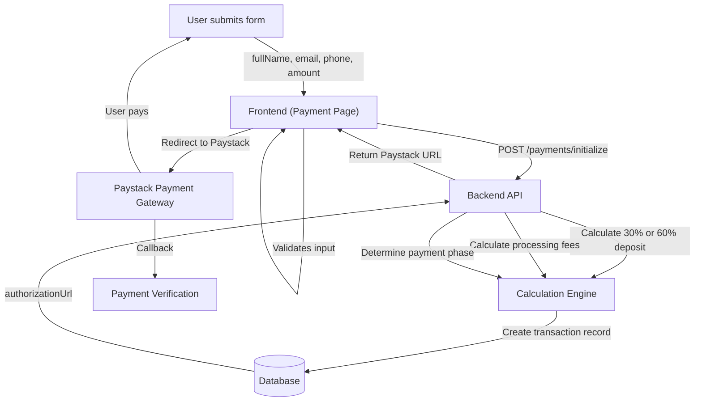

# Design Document: Remove Frontend Payment Calculations

## Overview

This refactoring moves payment calculation logic from the frontend to the backend. Currently, the frontend calculates deposit amounts (30%) and processing fees (1.5% + GHS 0.50), then sends the total to the backend. The new approach simplifies the frontend by having it send only the base amount (full project cost or course fee), allowing the backend to handle all financial calculations including the new 60% deposit requirement for projects.

## Architecture



## Components and Interfaces

### Component 1: ProjectPaymentPage (Frontend)

**Purpose**: Collect applicant contact information and redirect to Paystack payment gateway for project deposits.

**Key Changes**:
- Remove `calculateDepositAmount()` function
- Remove processing fee calculation
- Remove totalAmount calculation
- Update payment data object to send only base amount

**Updated Interface**:
```javascript
// Simplified payment data structure
const paymentData = {
  // Core required fields
  projectRequestId: string,        // Project request identifier
  amount: number,                  // Full project cost (GHS)
  currency: 'GHS',                // Payment currency
  paymentPhase: 'deposit',        // Payment phase
  
  // Applicant information
  studentName: string,             // Applicant full name
  studentEmail: string,            // Applicant email
  
  // Callback configuration
  callbackUrl: string,             // Post-payment verification URL
  
  // Optional project context
  projectTitle?: string,           // Project name
  projectType?: string             // Project category
}
```

**Responsibilities**:
- Validate form input (name, email, phone)
- Display payment summary with backend-calculated amounts
- Send simplified payment data to backend
- Handle errors from payment initialization
- Redirect to Paystack on success

### Component 2: TrainingPaymentPage (Frontend)

**Purpose**: Collect applicant contact information for training course enrollment payments.

**Key Changes**:
- Remove processing fee calculations from JSX
- Remove totalAmount calculations
- Send course fee as base amount only

**Updated Interface**:
```javascript
// Simplified payment data structure
const paymentData = {
  // Core required fields
  courseId: string,                // Course identifier
  amount: number,                  // Course fee (GHS)
  currency: 'GHS',                // Payment currency
  
  // Applicant information
  studentName: string,             // Applicant full name
  studentEmail: string,            // Applicant email
  
  // Callback configuration
  callbackUrl: string,             // Post-payment verification URL
  
  // Optional context
  applicationId?: string           // Training application ID
}
```

**Responsibilities**:
- Validate form input (name, email, phone)
- Display payment summary (course fee only)
- Send simplified payment data to backend
- Handle errors from payment initialization
- Redirect to Paystack on success

### Component 3: Backend Payment API

**Purpose**: Handle payment initialization with all financial calculations.

**Responsibilities**:
- Calculate deposit amounts (30% for training, 60% for projects)
- Calculate processing fees (1.5% + GHS 0.50)
- Validate payment amounts
- Create transaction records
- Determine payment phase
- Generate Paystack authorization URL

## Data Models

### ProjectPaymentRequest

```javascript
{
  // Input from frontend
  projectRequestId: UUID,
  amount: number,                  // Full project budget
  currency: 'GHS',
  paymentPhase: 'deposit',
  studentName: string,
  studentEmail: string,
  callbackUrl: string,
  
  // Optional context
  projectTitle?: string,
  projectType?: string
}
```

**Backend Calculations**:
- `depositAmount` = amount × 0.60 (60% for projects)
- `processingFee` = (depositAmount × 0.015) + 0.50
- `totalAmount` = depositAmount + processingFee
- `balanceDue` = amount - depositAmount

### TrainingPaymentRequest

```javascript
{
  // Input from frontend
  courseId: UUID,
  amount: number,                  // Course fee
  currency: 'GHS',
  studentName: string,
  studentEmail: string,
  callbackUrl: string,
  
  // Optional context
  applicationId?: UUID
}
```

**Backend Calculations**:
- `processingFee` = (amount × 0.015) + 0.50
- `totalAmount` = amount + processingFee

## Key Functions with Formal Specifications

### ProjectPaymentPage: handleSubmit()

**Signature**:
```javascript
handleSubmit(e: FormEvent): Promise<void>
```

**Preconditions**:
- Form validation passes (name, email, phone are valid)
- `projectRequestId` exists and is valid UUID
- `budgetRange` is provided and contains valid numeric values
- `import.meta.env.VITE_APP_URL` is configured or browser has window.location.origin

**Postconditions**:
- Either:
  - Payment initialization succeeds: window.location redirected to Paystack URL
  - Payment initialization fails: User shown alert with error message, `isProcessing` set to false
- `sessionStorage` contains `payment_reference` and `payment_project_id` (on success)
- No console errors logged (development only)

**Side Effects**:
- Sets `isProcessing = true` during processing
- Calls `paymentService.initializePayment(paymentData)`
- Stores payment reference in `sessionStorage`
- Redirects window location on success
- Displays alert on error

**Loop Invariants**: N/A (no loops)

### ProjectPaymentPage: calculateDepositAmount()

**Status**: REMOVED

**Reason**: Backend now performs all calculations

### TrainingPaymentPage: handleSubmit()

**Signature**:
```javascript
handleSubmit(e: FormEvent): Promise<void>
```

**Preconditions**:
- Form validation passes (name, email, phone are valid)
- `courseId` exists and is valid UUID
- `course` object is loaded and contains valid price
- `import.meta.env.VITE_APP_URL` is configured or browser has window.location.origin

**Postconditions**:
- Either:
  - Payment initialization succeeds: window.location redirected to Paystack URL
  - Payment initialization fails: User shown alert with error message, `isProcessing` set to false
- `sessionStorage` contains `payment_reference` and `payment_course_id` (on success)

**Side Effects**:
- Sets `isProcessing = true` during processing
- Calls `paymentService.initializePayment(paymentData)`
- Stores payment reference in `sessionStorage`
- Redirects window location on success
- Displays alert on error

**Loop Invariants**: N/A (no loops)

## Algorithmic Changes

### Project Payment Initialization (Before)

```pascal
PROCEDURE initializeProjectPayment(projectData)
  INPUT: projectData with budgetRange (e.g., "GHS 5,000 - GHS 10,000")
  OUTPUT: authorizationUrl from Paystack
  
  SEQUENCE
    // REMOVED: Frontend calculations
    budget_numbers ← EXTRACT_NUMBERS(projectData.budgetRange)
    min ← budget_numbers[0]
    max ← budget_numbers[1]
    midpoint ← (min + max) / 2
    
    depositAmount ← midpoint × 0.30  // REMOVED: Now done by backend
    processingFee ← (depositAmount × 0.015) + 0.50  // REMOVED
    totalAmount ← depositAmount + processingFee  // REMOVED
    
    // Send calculated amount to backend
    paymentData ← {
      projectRequestId,
      amount: totalAmount,  // REMOVED: Send total instead of base
      depositAmount,        // REMOVED
      depositPercentage,    // REMOVED
      processingFee,        // REMOVED
      balanceDue            // REMOVED
    }
    
    response ← POST /payments/initialize(paymentData)
    
    IF response.authorizationUrl EXISTS THEN
      STORE response.reference IN sessionStorage
      REDIRECT TO response.authorizationUrl
    ELSE
      SHOW ERROR "No payment URL received"
    END IF
  END SEQUENCE
END PROCEDURE
```

### Project Payment Initialization (After)

```pascal
PROCEDURE initializeProjectPayment(projectData)
  INPUT: projectData with fullProjectCost
  OUTPUT: authorizationUrl from Paystack
  
  SEQUENCE
    // NEW: Send only base amount
    paymentData ← {
      projectRequestId,
      amount: projectData.fullProjectCost,  // NEW: Base amount only
      currency: 'GHS',
      paymentPhase: 'deposit',
      studentName: formData.fullName,
      studentEmail: formData.email,
      callbackUrl: currentAppUrl + '/payment/verify'
    }
    
    // Backend handles all calculations
    response ← POST /payments/initialize(paymentData)
    
    IF response.authorizationUrl EXISTS THEN
      STORE response.reference IN sessionStorage
      REDIRECT TO response.authorizationUrl
    ELSE
      SHOW ERROR "No payment URL received"
    END IF
  END SEQUENCE
END PROCEDURE
```

## Example Usage

### Before (Frontend Calculations)

```javascript
// OLD: Frontend calculates everything
const budgetRange = "GHS 5,000 - GHS 10,000";
const numbers = budgetRange.match(/[\d,]+/g);
const min = parseFloat(numbers[0].replace(/,/g, ''));
const max = parseFloat(numbers[1].replace(/,/g, ''));
const midpoint = (min + max) / 2;
const depositAmount = midpoint * 0.30;  // GHS 2,250
const processingFee = (depositAmount * 0.015) + 0.50;  // GHS 33.88
const totalAmount = depositAmount + processingFee;  // GHS 2,283.88

const paymentData = {
  projectRequestId: 'proj-123',
  amount: totalAmount,  // Send total including fees
  currency: 'GHS',
  totalProjectBudget: midpoint,
  paymentPhase: 'deposit',
  studentName: 'John Doe',
  studentEmail: 'john@example.com',
  depositAmount: depositAmount,
  depositPercentage: 30,
  processingFee: processingFee,
  balanceDue: midpoint - depositAmount
};

await paymentService.initializePayment(paymentData);
```

### After (Backend Calculations)

```javascript
// NEW: Frontend sends base amount only
const fullProjectCost = 7500;  // GHS 7,500 full budget

const paymentData = {
  projectRequestId: 'proj-123',
  amount: fullProjectCost,  // Send base amount only
  currency: 'GHS',
  paymentPhase: 'deposit',
  studentName: 'John Doe',
  studentEmail: 'john@example.com',
  callbackUrl: 'https://app.zyratech.com/payment/verify'
};

// Backend now calculates:
// - depositAmount = 7500 × 0.60 = GHS 4,500 (60% for projects)
// - processingFee = (4500 × 0.015) + 0.50 = GHS 67.88
// - totalAmount = 4500 + 67.88 = GHS 4,567.88
// - balanceDue = 7500 - 4500 = GHS 3,000

const response = await paymentService.initializePayment(paymentData);
```

## Correctness Properties

### Property 1: Form Validation Consistency

For all payment pages:
```
∀ formData ∈ FormData:
  validateForm(formData) = true
  ⟹ (formData.fullName ≠ ∅ ∧ formData.email ≠ ∅ ∧ formData.phone is valid)
```

### Property 2: Backend Receives Base Amount

For project payments:
```
∀ projectBudget ∈ Number:
  handleSubmit(projectBudget)
  ⟹ POST /payments/initialize receives amount = projectBudget (not including fees)
```

For training payments:
```
∀ courseFee ∈ Number:
  handleSubmit(courseFee)
  ⟹ POST /payments/initialize receives amount = courseFee (not including fees)
```

### Property 3: No Frontend Financial Calculations

```
∀ paymentRequest ∈ Payment:
  paymentRequest = Frontend.preparePayment(...)
  ⟹ paymentRequest does NOT contain:
    - depositAmount (moved to backend)
    - processingFee (moved to backend)
    - depositPercentage (moved to backend)
    - totalAmount (calculated by backend)
    - balanceDue (calculated by backend)
```

### Property 4: Consistent Payment Flow

```
∀ formData ∈ ValidFormData:
  handleSubmit(formData)
  ⟹ (paymentInitialized ∧ sessionStorageUpdated ∧ redirectedToPaystack)
    ∨ (errorDisplayed ∧ processingReset ∧ ¬redirected)
```

## Error Handling

### Error Scenario 1: Missing Project Request ID

**Condition**: `projectRequestId` is null, undefined, or empty
**Response**: Alert user with message "Project request ID is missing. Please restart the request process."
**Recovery**: Navigate back to `/projects/request` form
**Behavior**: No API call is made

### Error Scenario 2: Invalid Budget Range

**Condition**: Budget range string cannot be parsed (e.g., missing currency formatting)
**Response**: Payment page displays error notification
**Recovery**: User returns to previous step and re-enters budget information
**Behavior**: Form submission prevented

### Error Scenario 3: Payment Initialization Failed

**Condition**: Backend returns error from `/payments/initialize` endpoint
**Response**: Alert user with error message from backend or generic "Failed to initialize payment"
**Recovery**: User can retry submission after addressing validation errors
**Behavior**: `isProcessing` flag reset to false, payment form remains visible

### Error Scenario 4: Missing Authorization URL

**Condition**: Backend returns success but `authorizationUrl` is missing from response
**Response**: Alert user with "No payment URL received"
**Recovery**: User can retry submission
**Behavior**: No redirect occurs, payment form remains visible

### Error Scenario 5: Network Timeout

**Condition**: API request times out during payment initialization
**Response**: Handled by axios error interceptor; user sees "Network error" or similar
**Recovery**: User can retry submission
**Behavior**: `isProcessing` flag reset to false

## Testing Strategy

### Unit Testing Approach

**Test: handleSubmit() with valid form data**
- Mock `paymentService.initializePayment`
- Mock `window.location.href`
- Verify payment data structure contains only base amount
- Verify no fee calculations in payload
- Verify sessionStorage is updated with reference

**Test: handleSubmit() with missing name**
- Verify form validation fails
- Verify error message displayed
- Verify no API call made

**Test: handleSubmit() with invalid phone**
- Verify phone validation runs
- Verify specific error message for phone format
- Verify no API call made

**Test: Form input validation**
- Test with empty strings
- Test with whitespace-only strings
- Test with valid values
- Verify error state management

### Integration Testing Approach

**Test: Full payment flow for projects**
- Fill form with valid data
- Submit form
- Verify backend receives correct payload structure
- Verify no financial calculations in payload

**Test: Full payment flow for training**
- Fill form with valid data
- Submit form
- Verify backend receives correct payload structure
- Verify no financial calculations in payload

**Test: Error handling from backend**
- Mock backend error response
- Verify error message displayed to user
- Verify form remains accessible for retry

### Property-Based Testing Approach

**Property Test Library**: fast-check

**Property 1: All form submissions send base amount**
```
fc.property(fc.object(), (payload) => {
  expect(payload.amount).toBeDefined()
  expect(payload.depositAmount).toBeUndefined()
  expect(payload.processingFee).toBeUndefined()
  expect(payload.totalAmount).toBeUndefined()
})
```

**Property 2: Payment data contains required fields**
```
fc.property(
  fc.uuid(),
  fc.number({ min: 100, max: 100000 }),
  fc.string(),
  fc.emailAddress(),
  (id, amount, name, email) => {
    const data = preparePaymentData(id, amount, name, email)
    expect(Object.keys(data)).toContain('projectRequestId')
    expect(Object.keys(data)).toContain('amount')
    expect(Object.keys(data)).toContain('currency')
    expect(Object.keys(data)).toContain('paymentPhase')
    expect(Object.keys(data)).toContain('studentName')
    expect(Object.keys(data)).toContain('studentEmail')
    expect(Object.keys(data)).toContain('callbackUrl')
  }
)
```

## Performance Considerations

- Frontend payload size reduced by removing financial calculation fields
- No performance impact on UI rendering (removed calculations were negligible)
- Backend now owns all financial computation (may slightly increase backend processing time, but still minimal)
- Network bandwidth unchanged significantly

## Security Considerations

**Improved Security**:
- Removing financial calculations from frontend eliminates risk of client-side manipulation
- All sensitive calculations now controlled server-side with proper validation
- Backend can enforce business rules and prevent fraudulent payment amounts
- Amount validation can include rate limiting and business logic checks

**Maintained Security**:
- SSL/TLS encryption for all API calls unchanged
- PCI-DSS compliance maintained
- Paystack integration unchanged
- Phone number validation in frontend still performed before backend submission

## Dependencies

- **Frontend**: React, React Router, Lucide Icons (no new dependencies)
- **Backend**: Payment processing logic, validation middleware (backend implementation)
- **External**: Paystack API (no changes)
- **Utilities**: `validatePhoneNumber()`, `getPhoneInputAttributes()` (unchanged)

## Files to Modify

1. **src/pages/public/projects/ProjectPaymentPage.jsx**
   - Remove `calculateDepositAmount()` function
   - Remove processing fee calculations
   - Remove totalAmount calculation
   - Update payment data object
   - Update UI text references to deposit percentages

2. **src/pages/public/training/PaymentPage.jsx**
   - Remove processing fee calculations from JSX
   - Remove totalAmount calculations
   - Update payment data object
   - Update UI text references to fee breakdowns

3. **Backend API** (not in scope for this design, but documented)
   - Add deposit calculation logic (60% for projects, 30% for training)
   - Add processing fee calculation (1.5% + GHS 0.50)
   - Update transaction record schema
   - Add business logic validation

## Migration Path

1. **Phase 1**: Update frontend components to send base amount only
2. **Phase 2**: Backend implements calculation logic and validates incoming amounts
3. **Phase 3**: Update payment summary display to show backend-calculated amounts
4. **Phase 4**: Remove deprecated fields from frontend state and localStorage
5. **Phase 5**: Monitor payments for accuracy during transition period
